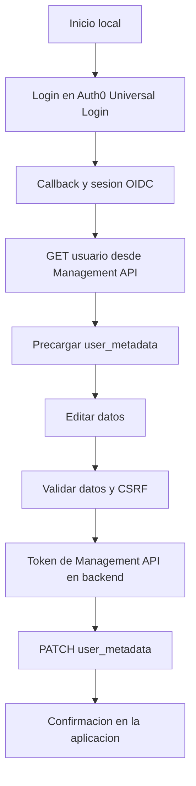

# Perfil ITM con Auth0

Aplicacion local para la actividad de Aplicaciones y servicios web. Permite iniciar sesion mediante Auth0 Universal Login, consultar cuatro datos personales y guardarlos en `user_metadata` utilizando Auth0 Management API v2.

## Requisitos

- Node.js 18 o posterior.
- Una cuenta/tenant de Auth0.
- Conexion a internet para completar el login y las solicitudes al tenant.

## Configuracion de Auth0

### Aplicacion de inicio de sesion

1. En Auth0 Dashboard, crea una aplicacion **Regular Web Application**.
2. Configura:
   - **Allowed Callback URLs:** `http://localhost:3000/callback`
   - **Allowed Logout URLs:** `http://localhost:3000`
   - **Allowed Web Origins:** `http://localhost:3000`
3. Guarda los cambios y copia el dominio, Client ID y Client Secret.

### Aplicacion Machine-to-Machine para el perfil

1. Crea una aplicacion **Machine to Machine** y autorizala para la API **Auth0 Management API**.
2. Concede unicamente los scopes `read:users` y `update:users`.
3. Copia el Client ID y Client Secret de esta aplicacion. No los incluyas en el navegador ni los subas a GitHub.

> El backend obtiene un token con `client_credentials`, usa la audiencia `https://{AUTH0_DOMAIN}/api/v2/` y mantiene las credenciales fuera del cliente. Para un entorno real, aplica el principio de minimo privilegio y almacena los secretos en un gestor de secretos.

### Acceso al endpoint protegido (paso 2)

El ejemplo `http://path_to_your_api/` es un marcador de posicion: para este proyecto, la API protegida es Auth0 Management API y se consume desde el servidor. Tras obtener el token, `src/auth0-management.js` lo envia como credencial en la cabecera HTTP de autorizacion al endpoint de lectura `GET https://{AUTH0_DOMAIN}/api/v2/users/{id}` y al endpoint de actualizacion `PATCH` de esa misma ruta.

El backend usa el `sub` de la sesion Auth0 como `{id}`; no acepta un ID de usuario arbitrario del navegador. La funcion `requestUser` comparte el envio del token de acceso para ambos metodos. No imprimas el token ni lo pongas en JavaScript del navegador.

## Instalacion y ejecucion local

Desde la carpeta del proyecto:

```powershell
npm install
Copy-Item .env.example .env
```

Edita `.env` y completa:

- `AUTH0_DOMAIN`: dominio del tenant sin `https://`.
- `AUTH0_CLIENT_ID` y `AUTH0_CLIENT_SECRET`: credenciales de la Regular Web Application.
- `AUTH0_SESSION_SECRET`: cadena aleatoria de al menos 32 caracteres.
- `AUTH0_MGMT_CLIENT_ID` y `AUTH0_MGMT_CLIENT_SECRET`: credenciales de la aplicacion Machine-to-Machine.

En PowerShell puedes generar un secreto de sesion con:

```powershell
node -e "console.log(require('node:crypto').randomBytes(32).toString('hex'))"
```

Inicia la aplicacion:

```powershell
npm start
```

Abre <http://localhost:3000>, inicia sesion y entra a **Editar mis datos**. Para ejecutar las pruebas unitarias: `npm test`.

## Personalizacion del Universal Login

La marca del login la administra el tenant de Auth0: ve a **Branding > Universal Login** (los nombres pueden variar segun la version del Dashboard), carga el logo oficial autorizado del ITM y configura colores y apariencia. La app redirige al Universal Login alojado por Auth0; por eso el cambio se hace en Auth0 y no en el CSS local. Toma una captura del resultado para la entrega.

## Datos guardados

El formulario usa estos atributos de `user_metadata`:

| Campo | Atributo |
|---|---|
| Tipo de documento | `document_type` |
| Numero de documento | `document_number` |
| Direccion | `address` |
| Telefono | `phone` |

El servidor consulta `GET /api/v2/users/{id}` para precargar los datos y utiliza `PATCH /api/v2/users/{id}` para guardar. El ID de usuario procede de la sesion OIDC autenticada, no de un valor enviado por el formulario. La solicitud POST valida los campos y un token CSRF.

La cabecera HTTP de autorizacion con esquema Bearer se crea en el servidor al consumir el endpoint protegido. No uses `http://path_to_your_api/` literalmente: para esta actividad, la URL concreta se forma con el dominio del tenant y el identificador de usuario autenticado.

## Estructura

```text
app.js                    Servidor Express y rutas
src/auth0-management.js   Token y solicitudes a Management API
src/csrf.js               Token de proteccion CSRF
src/profile.js            Lectura y validacion de campos del perfil
views/                    Plantillas EJS
public/styles.css         Estilos
test/                     Pruebas unitarias
docs/INFORME.md           Borrador del informe y diagrama de flujo
```

## Flujo


## Referencias

- [Auth0 Express Quickstart](https://auth0.com/docs/quickstart/webapp/express)
- [Auth0 Management API - Update a User](https://auth0.com/docs/api/management/v2/users/patch-users-by-id)
- [Auth0 Management API Access Tokens](https://auth0.com/docs/secure/tokens/access-tokens/management-api-access-tokens)
- [Auth0 - Customize Login Pages](https://auth0.com/docs/customize/login-pages)
