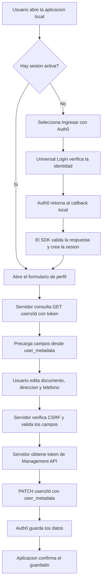

# Informe de la actividad - Integracion de Auth0

> Completa los campos entre corchetes con tu informacion, adapta la explicacion a lo que realizaste, agrega tus capturas propias y exporta el informe a PDF.

## Portada

- **Institucion:** Instituto Tecnologico Metropolitano (ITM)
- **Asignatura:** Aplicaciones y servicios web
- **Actividad:** Guia de Trabajo No. 3
- **Estudiante(s):** Luis Miguel Cardona
- **Programa:** Guia3
- **Docente:** Jonathan Sanchez Giraldo
- **Fecha:** 28/10/2026

## 1. Objetivo

Integrar Auth0 en una aplicacion web local para autenticar usuarios, mostrar y editar cuatro datos personales, y guardar dichos datos en `user_metadata` mediante Auth0 Management API.

## 2. Herramientas utilizadas

- Node.js y Express.
- `express-openid-connect`, SDK oficial de Auth0 para aplicaciones Express.
- Auth0 Universal Login y Auth0 Management API v2.
- HTML, EJS y CSS para la interfaz.

## 3. Desarrollo

### 3.1 Configuracion del inicio de sesion

Primero cree una aplicacion de tipo Regular Web Application en Auth0 para que el sitio pudiera iniciar el proceso de autenticacion. En la configuracion agregue las direcciones locales permitidas para callback, cierre de sesion y origen web. Luego conecte la aplicacion Node.js con el SDK `express-openid-connect`, que redirige al usuario al login alojado por Auth0 y administra la respuesta de autenticacion y la sesion.

En esta ejecucion local se uso `http://localhost:3001`, por lo tanto las direcciones configuradas fueron:

- Callback: `http://localhost:3001/callback`
- Logout: `http://localhost:3001`
- Web Origins: `http://localhost:3001`

**Captura 1 - Aplicacion local antes de iniciar sesion:**  
[Inserta una captura de la pagina principal abierta en `http://localhost:3001`.]

**Captura 2 - Universal Login:**  
[Pulsa “Ingresar con Auth0” e inserta una captura de la pagina de login de Auth0. No muestres contrasenas, secretos ni tokens.]

### 3.2 Personalizacion de Universal Login

Despues de comprobar que el login funcionaba, abri **Branding > Universal Login** en Auth0, cargue un logo institucional autorizado y ajuste la apariencia disponible en el Dashboard. Esta personalizacion pertenece al tenant de Auth0: la aplicacion local redirige a esa pagina y no reemplaza su diseno con el CSS del sitio.

**Captura 3 - Branding aplicado:**  
[Inserta una captura del Universal Login personalizado. Si el tenant no permite el cambio esperado, describe aqui lo que configuraste realmente.]

### 3.3 Edicion del perfil

Al completar el login, entre a la opcion para editar mis datos. La aplicacion identifica al usuario mediante su sesion y consulta su perfil en Auth0 Management API. Con la informacion de `user_metadata` se precargan el tipo y numero de documento, la direccion y el telefono; si esos atributos todavia no existen, aparecen vacios.

**Captura 4 - Formulario con campos precargados o vacios:**  
[Inserta una captura de `/profile`. Puedes usar un usuario de prueba y datos ficticios; no incluyas informacion personal real.]

### 3.4 Guardado en `user_metadata`

Al enviar el formulario, el servidor valida los cuatro valores y verifica la solicitud. Luego solicita a Auth0 un token de acceso de Management API mediante `client_credentials`, usando las credenciales de servidor de la aplicacion Machine-to-Machine. El token se envia en la cabecera de autorizacion de la solicitud a la API; nunca se entrega al navegador.

Para leer los datos usa `GET /api/v2/users/{id}` y para guardarlos usa `PATCH /api/v2/users/{id}`, enviando los cuatro atributos dentro de `user_metadata`. El ID se obtiene de la sesion autenticada y no de un valor libre del formulario. El ejemplo `http://path_to_your_api/` de Auth0 es solo un marcador: aqui se llama al endpoint real de Management API del tenant.

**Captura 5 - Resultado del guardado y perfil actualizado en Auth0:**  
[Inserta una captura del mensaje de confirmacion despues de guardar. Para mostrar la persistencia, abre el usuario de prueba en **User Management > Users** en Auth0 y captura su `user_metadata`. Oculta correo u otros datos personales si aparecen.]

**Captura 6 - Codigo de actualizacion de `user_metadata`:**  
[Inserta una captura de `src/auth0-management.js` donde se solicita el token y se envia la peticion PATCH, y otra de `app.js` donde se llama a `updateUserMetadata`. No captures ni pegues el archivo `.env`, secretos o tokens.]

## 4. Diagrama de flujo

El flujo comienza con la autenticacion en Auth0; una vez establecida la sesion, el usuario consulta y modifica su perfil. El servidor obtiene el token de Management API y lo usa para actualizar el registro del mismo usuario autenticado.



Si el documento final se redacta en un editor que no representa diagramas Mermaid, usa la vista previa de GitHub para mostrar el diagrama o convierte este flujo en una imagen y agregala al documento.

## 5. Capturas secuenciales requeridas

Organiza las evidencias en este orden y agrega un pie de imagen con una frase que explique lo que demuestra cada una:

1. Pagina inicial de la aplicacion corriendo localmente.
2. Universal Login de Auth0 antes de iniciar sesion.
3. Universal Login con la personalizacion institucional aplicada.
4. Formulario de perfil abierto despues de autenticarse.
5. Datos de prueba completados y confirmacion despues de guardar.
6. `user_metadata` actualizado en el usuario de prueba dentro del Dashboard de Auth0.
7. Codigo de la solicitud PATCH y su llamada desde la ruta del formulario.

Toma las capturas con la aplicacion funcionando. No incluyas contrasenas, archivos `.env`, Client Secrets ni access tokens. Si una captura muestra datos personales, usa informacion ficticia o difuminala.

## 6. Pruebas realizadas

- [ ] Inicio de sesion y cierre de sesion.
- [ ] Redireccion al formulario para usuarios autenticados.
- [ ] Formulario vacio cuando `user_metadata` no tiene esos campos.
- [ ] Precarga de datos existentes.
- [ ] Rechazo de datos invalidos.
- [ ] Actualizacion correcta y persistencia de los cuatro atributos en Auth0.
- [ ] Repositorio publicado en GitHub y compartido con `jonathansanchez2948@correo.itm.edu.co`.

## 7. Publicacion del proyecto y acceso del docente

1. En GitHub, crea un repositorio nuevo, por ejemplo `itm-auth0-perfil`. Para esta entrega puedes elegir privado si compartiras el acceso con el docente.
2. En la carpeta local del proyecto, comprueba que `.gitignore` contiene una linea `.env`. Inicializa Git si todavia no existe y verifica que el archivo se ignora:

   ```powershell
   git init
   git check-ignore .env
   ```

   El segundo comando debe mostrar `.env` como ignorado. Luego ejecuta:

   ```powershell
   git add .
   git status
   ```

   Revisa la lista de `git status`: no debe aparecer `.env`, ningun secreto ni `node_modules`. Si aparecen, no hagas el commit y corrige `.gitignore`.
4. Guarda la primera version y conecta el repositorio de GitHub (reemplaza `TU_USUARIO` por tu nombre de usuario):

   ```powershell
   git commit -m "Completa proyecto de perfil con Auth0"
   git branch -M main
   git remote add origin https://github.com/TU_USUARIO/itm-auth0-perfil.git
   git push -u origin main
   ```

   Si ya existe un `origin`, revisa `git remote -v` y usa la direccion correcta en vez de volver a agregarlo.
5. En la pagina del repositorio de GitHub, ve a **Settings > Collaborators** (o **Collaborators and teams**), elige **Add people** y busca `jonathansanchez2948@correo.itm.edu.co`. Envia la invitacion y espera que el docente la acepte.
6. Copia el enlace del repositorio en la entrega. Incluye una captura del repositorio publicado y, si el repositorio es privado, de la invitacion enviada; oculta informacion que no sea necesaria.

## 8. Bibliografia

1. Auth0. *Add Login to Your Express Application*. https://auth0.com/docs/quickstart/webapp/express
2. Auth0. *Management API v2 - Update a User*. https://auth0.com/docs/api/management/v2/users/patch-users-by-id
3. Auth0. *Management API Access Tokens*. https://auth0.com/docs/secure/tokens/access-tokens/management-api-access-tokens
4. Auth0. *Customize Login Pages*. https://auth0.com/docs/customize/login-pages
